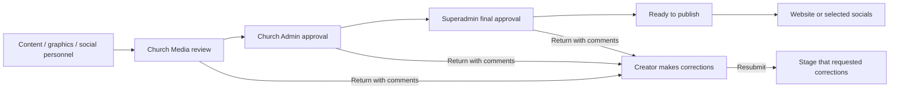

# Media approval and readable text

Completed media uploads, including YouTube sermon links, now enter review automatically. **Upload & submit** sends the item to the next stage; **Save as draft** keeps it private for later editing. The same server policy handles single uploads, batch uploads and uploaded-video references. Event flyers still link the program before submission. Existing drafts remain drafts and can be submitted from Media → Workflow; deployment does not submit unfinished work on someone else's behalf.

Default routing:



Submissions begin above the uploader's own level: Church Media submits to Church Admin; Church Admin submits to Superadmin. Superadmin uploads can become ready immediately and Superadmin may override any pending stage. Approval and publishing remain separate operations. Changing the upload source to a YouTube URL does not bypass review.

Only Superadmin can change **Media → Workflow → Media approval policy**. Church Admin and other users do not receive that control, and direct API attempts are rejected with 403. Approval is enabled by default. Disabling it makes subsequent submissions/forwarding ready to publish. It does not publish them automatically or silently move pending items. This exception is read from stored server settings; an uploader cannot grant an exemption through an upload parameter. Existing social connection secrets are untouched.

Queues come from media workflow status, rather than from approval-decision rows. Each normal queue contains only the stage assigned to that reviewer: Church Admin sees AdminApproval, and Superadmin sees SuperAdminApproval. A submission does not appear in a later stage until the current reviewer forwards it. Superadmin's separate **Media → Approval audit** shows earlier submitted stages, their current holder, time waiting and last action for oversight. Earlier-stage overrides remain separate from the normal queue. Decisions and returns remove items from the previous queue. The dashboard and sidebar refresh on focus, every 30 seconds while visible, and after in-app workflow mutations. Both standard and configured dashboards show the pending media count to authorised approvers. The separate administrative card is labelled **Pending certificate approvals** to avoid confusing it with media review.

Text changes strengthen public-page colours, captions, sidebar labels, dashboard notes and badges. Primary buttons use darker fills where white text needs more contrast. Text over homepage video and gallery photos has a stronger backdrop. Form-button text is selected using the actual accent-colour contrast and meets at least 4.5:1, including middle-tone custom colours. Small form/builder labels were increased to 12 pixels; this affects the website and PWA through shared styles, without changing certificate document typography.

## Deployment and verification

Deploy both applications. Apply main-context migration **20261119080345_MediaApprovalPolicy**; existing installations receive `MediaApprovalRequired=true`. There is no reporting-context migration.

In Visual Studio's backend Package Manager Console:

```powershell
Update-Database -Context DayspringDbContext
```

Backend tests cover automatic YouTube routing for each role, actual queue visibility, explicit drafts, stored exceptions, final approval, returns/resubmission and event-flyer transactions. Frontend tests cover form-accent contrast. The local browser fixture checks standard/configured dashboards, refreshed counts, protected setting controls, mobile standalone layout and the actual YouTube upload form. It uses synthetic accounts and does not make production approvals.

## Progress, publishing badge and database correction

Each media detail page shows an **Approval progress** bubble tracker alongside the full timestamped history. It identifies the current role, completed/skipped stages, the creator and correction comments. Workflow lists refresh when the page regains focus, on workflow actions and every 30 seconds while visible. The dashboard pending card links directly to publishable approvals.

The **Media → Publishing** badge counts ReadyToPublish items, across the publishing team's authorised content. It decreases after publication; normal approval badges contain only the reviewer's own stage.

The generic publishing 409 was reproduced locally for an approved YouTube sermon. PostgreSQL rejected the missing series ID because `sermons.series_id` was configured as required even though the domain and publishing form make series optional. Main-context migration **20261119122804_OptionalSermonSeriesForPublishing** makes that column nullable without removing existing series links. Apply it with `Update-Database -Context DayspringDbContext` (or the configured startup migration process), then deploy the backend and frontend. No reporting-context migration or social-secret change is required.
